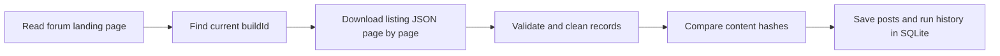

# Agnos Forum Data Pipeline

A Python project for collecting questions and doctor answers from the
[Agnos Health forum](https://www.agnoshealth.com/forums).

**Current milestone: download forum data, store it in SQLite, and detect changes on repeat runs.**
Embedding and search are the next stages. This is a partial implementation of the
assignment's chatbot bonus; it does not generate answers yet.

## 1. What is ready?

| Part | Status | What it does |
| --- | --- | --- |
| Scraper | Working | Reads forum listing pages, including questions and doctor answers |
| Data validation | Working | Checks required fields and cleans text before saving |
| SQLite storage | Working | Stores posts locally without duplicate IDs |
| Change detection | Working | Labels each fetched record as new, updated, or unchanged |
| Run history | Working | Records counts, timestamps, and errors for each scrape |
| Sitemap discovery | Planned | Finds additional threads missing from the listing |
| Embedding + Qdrant | Planned | Converts answered posts into vectors for semantic search |
| Search CLI + evaluation | Planned | Returns relevant threads and measures retrieval quality |
| LLM chatbot | Optional later work | Generates answers using retrieved threads |

## 2. Have we downloaded real data?

**Yes.** On October 28, 2026, the installed CLI was run twice against the live
website with a limit of 10 records. Each run fetched two listing pages.

| Run | New | Updated | Unchanged | Failed | Total stored posts |
| --- | ---: | ---: | ---: | ---: | ---: |
| First download | 10 | 0 | 0 | 0 | 10 |
| Repeat download | 0 | 0 | 10 | 0 | 10 |

The local database was checked again on October 29: it still contains **10 posts,
all with doctor answers**, and the latest run has no errors. This was a check of
existing local data, not another scrape.

These are sample runs, not a download of the entire forum. Changed-answer handling
has been tested with synthetic data; no live forum content was edited.

## 3. Where is the data stored?

The main data file is **`data/agnos.sqlite3`**, a SQLite database. It is not a CSV
or a plain JSON file, and it does not need a separate database server.

```text
data/
├── agnos.sqlite3          # Main database used by the CLI
└── probe/                # Local files from the initial website investigation
    ├── forums.html       # Saved forum landing-page HTML
    ├── listing.json      # Saved JSON from one listing page
    └── check.sqlite3     # Scratch database used to check storage behavior
```

Normal scraping writes to `agnos.sqlite3`; it does not save a new HTML or JSON
file on every run. The files under `probe/` are investigation artifacts, not inputs
required by the scraper.

The main database has three tables:

| Table | Contents |
| --- | --- |
| `posts` | One row per thread: source ID and URL, question, doctor answers, tags, disease label, age/gender, answer status, content hash, and timestamps |
| `scrape_runs` | One row per run: start/end time, status, pages fetched, and outcome counts |
| `scrape_errors` | Failure details associated with a run, page, and thread where available |

Inside `posts`, `tags_json` and `doctor_answers_json` contain JSON arrays stored
as text. The rest of the record uses ordinary SQLite columns.

All files under `data/` are excluded from Git. The assignment identifies the
source data as proprietary, so scraped records and derived indexes must remain
local. The scraper discards ordinary user comments and author-profile fields;
question and answer text may still contain personal information.

## 4. How does the scraper collect data?



1. **Read the forum landing page.** The scraper uses HTTP requests through
   `httpx`; it does not need a browser or Selenium.
2. **Find the current `buildId`.** The site's Next.js HTML includes a
   `__NEXT_DATA__` script. The scraper reads its `buildId`, which identifies the
   website build. This value is discovered on each CLI run, not hardcoded.
3. **Fetch listing pages as JSON.** Requests use this route, with an increasing
   page number:

   ```text
   https://www.agnoshealth.com/_next/data/{buildId}/th/forums/search.json?page=N
   ```

   In the sample run, each page contained eight threads. The response already
   included their questions, tags, and doctor answers, so no separate request per
   thread was needed. For a 10-record limit, the scraper reads two pages and saves
   only the first 10 unique records.
4. **Validate and clean each record.** Pydantic checks the structure. Text cleanup
   removes invisible characters and normalizes whitespace. Ordinary comments and
   author profiles are omitted from the stored record.
5. **Save the record and log the result.** SQLite uses the forum ID to identify
   an existing thread and a SHA-256 content hash to detect changed content.

The JSON route is an observed website implementation detail, not a guaranteed
public API. The scraper has request spacing of at least one second by default,
up to three attempts for temporary failures, and an HTML fallback. A data-route
404 triggers one `buildId` refresh before fallback. Unexpected record structures
are logged rather than silently saved as complete answers.

## 5. How do updates work?

Run the same scrape command again. Each fetched record has one of these outcomes:

| Outcome | Meaning | Database behavior |
| --- | --- | --- |
| `new` | The forum ID has not been stored | Insert a row |
| `updated` | The ID exists, but its content hash changed | Update the existing row |
| `unchanged` | The ID and content hash match | Refresh the last-seen time; keep the content-update time |

The hash includes normalized question and doctor-answer text, tags, disease,
age/gender, and answer availability. It ignores likes, ordinary comments, and
edit timestamps. A pending thread can become answered on a later run. If a
response claims to be answered but contains no doctor text, it is rejected so
it cannot overwrite a complete stored answer.

**Current limitation:** requested listing pages are downloaded again on every
run. Hash comparison detects changes after fetching; it does not yet reduce
network traffic. There is no scheduler, sitemap-based incremental crawl, or
deletion detection yet.

## 6. Run it locally

Run the following commands from `LLM-chatbot/`. Python 3.11+ is required.

### First-time setup

```bash
python3 -m venv .venv
source .venv/bin/activate
python -m pip install -e '.[dev]'
```

For an existing setup, only activate the environment:

```bash
source .venv/bin/activate
```

### Download a small sample and check it

```bash
agnos-rag scrape --limit 10
agnos-rag stats
```

Repeat the scrape to check change detection. If the source content is unchanged,
the summary should report `unchanged_count: 10`.

`stats` reads local data and does not contact the website. Both commands print
JSON summaries. `python -m agnos_rag` can be used instead of `agnos-rag`.

### Other useful commands

```bash
# Traverse the entire listing, rather than stopping at 10 records.
agnos-rag scrape --all

# Limit both the record count and the number of pages; slow requests to one every 2 seconds.
agnos-rag scrape --limit 20 --max-pages 3 --interval 2

# Use a separate database for an experiment.
agnos-rag scrape --limit 10 --db data/demo.sqlite3
agnos-rag stats --db data/demo.sqlite3
```

Database paths are relative to your working directory. `--all` covers listing
pages only; threads absent from the listing are not discovered yet. A completed
bounded run means the requested slice finished, not that the whole site was collected.
Records are not deleted merely because they are missing from a run.

Exit codes: `0` for success, `1` for a failed or partial run, and `130` for an
interruption. Already committed records remain stored after a failed fetch.

### Inspect the database

Use `agnos-rag stats` for a quick summary. If the `sqlite3` command is installed,
you can also inspect tables and records directly:

```bash
sqlite3 -readonly data/agnos.sqlite3 ".tables"

sqlite3 -readonly -header -column data/agnos.sqlite3 \
  "SELECT id, status, substr(question, 1, 80) AS question_preview FROM posts LIMIT 5;"
```

## 7. Find your way around the code

| File | Responsibility |
| --- | --- |
| [cli.py](src/agnos_rag/cli.py) | Defines `scrape` and `stats`, their options, and exit codes |
| [scraper.py](src/agnos_rag/scraper.py) | Sends requests, finds `buildId`, reads pages, retries failures, and runs the scrape |
| [schemas.py](src/agnos_rag/schemas.py) | Validates source records, cleans text, and calculates content hashes |
| [storage.py](src/agnos_rag/storage.py) | Creates SQLite tables, saves records, and records run history |
| [tests/](tests/) | Tests behavior with synthetic records and mocked HTTP |

## 8. Checks and next steps

The last code validation on October 28, 2026 passed **20 tests**, lint, and
formatting checks. The tests cover duplicate prevention, changed answers,
pagination, pending-to-answered transitions, incomplete data, build changes,
HTML fallback, retries, request spacing, and interrupted runs. No network or
models are needed to run them:

```bash
python -m pytest -q
python -m ruff check src tests
python -m ruff format --check src tests
```

The next milestones are:

1. Add sitemap discovery and thread-detail fetching for missing records.
2. Embed new or changed answered posts using `bge-m3` through Ollama, then store
   vectors in local Qdrant.
3. Add a search command that returns relevant threads with scores and links.
4. Evaluate retrieval and prepare the Google Slides pipeline overview.

Embedding, semantic search, retrieval evaluation, and scheduling are not implemented
yet. An LLM, chat UI, and API remain optional later work. This project is separate
from the main symptom-recommender assignment, which remains the priority.
